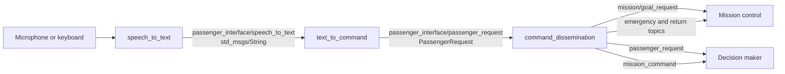

# Passenger Interface

`passenger_interface` connects spoken passenger requests to ADORe's ROS 2
interfaces. It records or simulates speech, transcribes it with Whisper,
classifies it as a supported vehicle action, and translates the result into
messages consumed by mission control and the decision maker.

The package supports two independent simulation switches:

- `only_simulate` replaces microphone/Whisper input with text entered in the
  speech-to-text node's terminal.
- `simulation` replaces Ollama classification with a deterministic,
  rule-based classifier.


## Pipeline



### Nodes and concepts

1. **`speech_to_text`** captures one selected audio channel, detects utterances
   using an RMS threshold, and transcribes completed utterances with
   `faster-whisper`. In keyboard simulation mode, it publishes entered text
   directly.
2. **`text_to_command`** optionally corrects the transcript and classifies it
   into a constrained action using Ollama. It then extracts details such as a
   destination, roundabout exit, coordinate pair, or driving-style factor and
   publishes an `adore_ros2_msgs/msg/PassengerRequest`.
3. **`command_dissemination`** turns requests requiring dedicated handling
   into mission goals or mission commands. Other supported requests are
   forwarded to the decision maker.

Named destinations are configured in
[`passenger_interface/locations.json`](passenger_interface/locations.json):

```json
{
  "airport": { "x": 603629.97, "y": 5793820.95 },
  "supermarket": { "x": 30.0, "y": -12.0 }
}
```

Names are matched case-insensitively. Coordinates must use the same world/UTM
coordinate system as the active ADORe map. A command such as `drive to the
airport` resolves the name and publishes a stopping goal. A command containing
two numbers, for example `drive to 606450.0 5797277.0`, uses those numbers
directly as `x` and `y`.

## ROS interface

All relative topic names below are placed below the configured namespace. The
default launch namespace is `/ego_vehicle`.

| Node | Direction | Topic | Type / purpose |
| --- | --- | --- | --- |
| `speech_to_text` | publish | `passenger_interface/speech_to_text` | `std_msgs/msg/String`; transcript |
| `text_to_command` | subscribe | `passenger_interface/speech_to_text` | transcript |
| `text_to_command` | publish | `passenger_interface/passenger_request` | `adore_ros2_msgs/msg/PassengerRequest` |
| `command_dissemination` | subscribe | `passenger_interface/passenger_request` | interpreted passenger request |
| `command_dissemination` | subscribe | `emergency_stop_started` | emergency-stop feedback |
| `command_dissemination` | publish | `passenger_request` | requests handled by the decision maker |
| `command_dissemination` | publish | `mission/goal_request` | `adore_ros2_msgs/msg/GoalPoint` |
| `command_dissemination` | publish | `mission_command` | `adore_ros2_msgs/msg/MissionCommand` |
| `command_dissemination` | publish | `emergency_stop_request` | `std_msgs/msg/Bool` |
| `command_dissemination` | publish | `mission/drive_back_to_start` | `std_msgs/msg/Bool` |

## Build and prerequisites

### Install Ollama and download the command model

On the Linux host that will run Ollama:

```bash
curl -fsSL https://ollama.com/install.sh | sh
sudo systemctl start ollama
systemctl status ollama --no-pager
```

If running without systemd, start the server in a dedicated terminal and leave
it running:

```bash
ollama serve
```

With the server running, use **another terminal** to download and test the
Mistral model used in the startup examples:

```bash
ollama pull mistral-small:24b-instruct-2501-q8_0
ollama ls
ollama run mistral-small:24b-instruct-2501-q8_0 'Reply with OK.'
ollama ps
```

The package default is `qwen3.5:4b`. To run without overriding `model_name`,
download that model as well (or instead):

```bash
ollama pull qwen3.5:4b
```

Run this connectivity check from the environment where the ROS nodes run:

```bash
curl --fail --silent --show-error http://localhost:11434/api/tags
```

The returned model list must include the tag you select. The ADORe CLI uses host
networking on Linux, so it can reach a host Ollama server at `localhost:11434`.
For a remote server, set `ollama_base_url:=http://SERVER:11434` at launch and
download the model on that server. `model_name` must match its installed tag.


### Download Whisper and choose CPU or GPU

Whisper downloads separately from Ollama. The speech node downloads a missing
model on first startup. To prepare the default model ahead of time, run this
in the same environment and user account as the speech node:

```bash
# Match the cache selected by demoSimulation.py.
export HF_HOME="${SOURCE_DIRECTORY:-$HOME}/.cache/huggingface"
export HF_HUB_DISABLE_XET=1
export HF_HUB_DOWNLOAD_TIMEOUT=120
python3 - <<'PY'
from faster_whisper import WhisperModel
WhisperModel("large-v3-turbo", device="cpu", compute_type="int8")
print("Whisper model cached")
PY
```

This loads on CPU to populate the cache; the same model can subsequently run
on GPU. Keep these environment variables when starting individual nodes to
reuse the launch file's cache. For a smaller first test, download `tiny.en`
instead and pass `whisper_model_size:=tiny.en` (English only).

The launch defaults use `cuda` / `float16`. For CPU, pass
`whisper_device:=cpu whisper_compute_type:=int8`. To inspect GPU support from
the node's environment:

```bash
nvidia-smi
python3 - <<'PY'
import ctranslate2
print("CUDA devices:", ctranslate2.get_cuda_device_count())
print("CPU compute types:", ctranslate2.get_supported_compute_types("cpu"))
if ctranslate2.get_cuda_device_count():
    print("CUDA compute types:", ctranslate2.get_supported_compute_types("cuda"))
PY
```

GPU execution needs a visible NVIDIA GPU and compatible CUDA/cuDNN libraries.
The ADORe CLI container is started with `--gpus all`. `demoSimulation.py`
prepends the pip-installed cuBLAS/cuDNN directories to `LD_LIBRARY_PATH`.
When starting the speech node without that launch file, set them manually:

```bash
CUDA_LIBS=$(python3 -c 'import nvidia.cublas, nvidia.cudnn; print(nvidia.cublas.__path__[0] + "/lib:" + nvidia.cudnn.__path__[0] + "/lib")')
export LD_LIBRARY_PATH="$CUDA_LIBS${LD_LIBRARY_PATH:+:$LD_LIBRARY_PATH}"
```

See [Faster-Whisper's GPU requirements](https://github.com/SYSTRAN/faster-whisper#gpu)
for compatible libraries. Selecting CPU avoids the GPU runtime requirement.

## Find and test the audio settings

Run all audio checks **where `speech_to_text` will run**, including inside the
container if applicable. Stop any existing speech node before opening the
microphone for these tests.

### Find the input device

```bash
python3 -m sounddevice       # PortAudio indices used by audio_device
arecord -l                   # ALSA capture hardware
arecord -L                   # ALSA device names
alsamixer                    # F6: choose card; F4: capture gain/mute controls
```

Choose a device with input channels. ALSA card numbers from `arecord` are
**not** PortAudio device indices. Recheck indices after reconnecting devices.
The launch defaults (`audio_device=4`, four channels, selected channel 3) are
hardware-specific. A mono microphone normally uses `audio_channels=1` and
`audio_channel=0`. `audio_device=-1` selects PortAudio's default input.

### If audio is missing inside Docker

Compare `arecord -l`, `python3 -m sounddevice`, and `ls -l /dev/snd` on the host
and inside the container. The checked-in ADORe CLI service does not map sound
devices. For direct ALSA access, add these entries under
`services.adore_cli` in `adore_cli/adore_cli.yaml` (path relative to the
repository root):

```yaml
devices:
  - /dev/snd:/dev/snd
group_add:
  - "29"  # Replace with the actual host sound-device group ID below.
```

Find that numeric group ID on the host:

```bash
stat -c '%g %n' /dev/snd/*
```

Recreate the container after changing its configuration, then repeat the
audio checks.

## Start the project

Start the ADORe vehicle stack first so that mission control and the decision
maker exist in the same namespace. For example, from the repository root in
a sourced ADORe CLI terminal:

```bash
ros2 launch adore_scenarios/simulation_scenarios/dlr_campus.launch.py
```

In another sourced terminal **at the repository root**, start all three
nodes using Mistral and the four-channel microphone / CUDA setup:

```bash
ros2 launch \
  ros2_workspace/src/adore_ros2_nodes/passenger_interface/launchfiles/demoSimulation.py \
  simulation:=False \
  model_name:=mistral-small:24b-instruct-2501-q8_0 \
  ollama_base_url:=http://localhost:11434 \
  whisper_model_size:=large-v3-turbo \
  whisper_device:=cuda whisper_compute_type:=float16 \
  audio_device:=4 audio_channels:=4 audio_channel:=3 audio_sample_rate:=48000
```

```bash
ros2 launch \
  ros2_workspace/src/adore_ros2_nodes/passenger_interface/launchfiles/demoSimulation.py \
  audio_device:=8 audio_channels:=1 audio_channel:=0 audio_sample_rate:=16000
```

Use `python3 -m sounddevice` to list audio-device indices. Pass `-1` as
`audio_device` to use PortAudio's default input device.

### Test without a microphone

For a fully local test, start the three pipeline nodes in separate sourced
terminals. The first command uses terminal input instead of opening Whisper or
an audio device; the second command bypasses Ollama:

```bash
ros2 run passenger_interface speech_to_text --ros-args \
  -r __ns:=/ego_vehicle -p only_simulate:=true
```

```bash
ros2 run passenger_interface text_to_command --ros-args \
  -r __ns:=/ego_vehicle -p simulation:=true
```

```bash
ros2 run passenger_interface command_dissemination --ros-args \
  -r __ns:=/ego_vehicle \
  -p "location_table_path:=$(ros2 pkg prefix --share passenger_interface)/locations.json"
```

Enter a command such as `drive to the airport` in the first terminal. You can
also bypass the speech-to-text node and inject a transcript directly:

```bash
ros2 topic pub --once /ego_vehicle/passenger_interface/speech_to_text \
  std_msgs/msg/String "{data: 'drive to the airport'}"
```

The command generator can publish predefined test commands to the same topic:

```bash
# One-shot destination command (command 21)
ros2 launch passenger_interface simulation.launch.py \
  interactive:=false number:=21 destination:=airport

# Interactive command selection
ros2 launch passenger_interface simulation.launch.py interactive:=true
```

`simulation.launch.py` only generates transcript messages; the
`text_to_command` and `command_dissemination` nodes must already be running.

`simulation:=true` on the main launch only bypasses Ollama; it still opens
the microphone and Whisper. `only_simulate` is not exposed by that launch;
use the individual keyboard-input node above for a test without audio.

### Inspect configuration and follow a request

```bash
ros2 launch passenger_interface demoSimulation.py --show-args
ros2 node list
ros2 node info /ego_vehicle/speech_to_text
ros2 param get /ego_vehicle/speech_to_text audio_device
ros2 param get /ego_vehicle/speech_to_text audio_channel
ros2 topic list -t
```

Run each echo in a separate terminal, then speak or publish a test transcript:

```bash
ros2 topic echo /ego_vehicle/passenger_interface/speech_to_text
```

```bash
ros2 topic echo /ego_vehicle/passenger_interface/passenger_request
```

```bash
ros2 topic echo /ego_vehicle/mission/goal_request
```

A destination request should appear at all three stages. If the transcript
is missing, check audio levels and Whisper startup logs. If the transcript
appears but the interpreted request does not, check Ollama connectivity and
the model tag. If the goal is published but the vehicle does not react, check
the vehicle namespace and mission-control subscriptions:

```bash
ros2 topic info /ego_vehicle/mission/goal_request --verbose
```

Replace `/ego_vehicle` throughout when using another namespace. All terminals
must also share the ROS discovery configuration, including `ROS_DOMAIN_ID`.

## ROS parameters

Parameters are read during node initialization. Supply them through a launch
argument, a ROS parameter file, or `--ros-args -p name:=value` when starting an
individual node. Audio parameters are not declared when `only_simulate` is
`true`, because the node returns before initializing its audio subsystem.

### `speech_to_text`

| Parameter | Type | Node default | Meaning |
| --- | --- | --- | --- |
| `whisper_model_size` | string | `large-v3-turbo` | Faster-Whisper model name or path. |
| `whisper_device` | string | `cuda` | Inference device, commonly `cuda` or `cpu`. |
| `whisper_compute_type` | string | `float16` | Faster-Whisper compute type; use `int8` commonly on CPU. |
| `whisper_language` | string | empty | Language code such as `en`; empty enables automatic detection. |
| `whisper_hotwords` | string | `lane, roundabout, U-turn, start point, Spurwechsel, Kreisverkehr` | Terms supplied to Whisper as recognition hints. |
| `only_simulate` | bool | `false` | Read text from stdin instead of opening Whisper and an audio device. |
| `audio_device` | int | `4` | PortAudio input-device index; `-1` selects the default device. |
| `audio_channels` | int | `4` | Number of channels opened from the input device. |
| `audio_channel` | int | `3` | Zero-based channel extracted for recognition. Must be below `audio_channels`. |
| `audio_sample_rate` | int | `48000` | Input-device sample rate in Hz; audio is resampled to 16 kHz for Whisper. |
| `audio_chunk_duration` | double | `0.1` | Duration in seconds of each captured audio block. |
| `end_silence_duration` | double | `0.7` | Silence required to finish an utterance. The main launch file overrides this to `1.2`. |
| `pre_roll_duration` | double | `0.3` | Audio retained before speech detection. |
| `max_utterance_duration` | double | `8.0` | Maximum buffered utterance length in seconds. |
| `min_audio_rms` | double | `0.005` | RMS level at or above which a chunk is considered speech. |
| `max_no_speech_probability` | double | `0.6` | Discard Whisper segments whose no-speech probability exceeds this value. |
| `vad_filter` | bool | `true` | Enable Faster-Whisper's voice-activity filter during transcription. |

### `text_to_command`

| Parameter | Type | Default | Meaning |
| --- | --- | --- | --- |
| `model_name` | string | `qwen3.5:4b` | Ollama model used for correction and classification. |
| `ollama_base_url` | string | `http://localhost:11434` | Ollama-compatible server base URL. |
| `enable_stt_correction` | bool | `true` | Allow minimal transcript correction in the constrained LLM request. |
| `simulation` | bool | `false` | Use the local rule-based classifier instead of Ollama. |

### `command_dissemination`

| Parameter | Type | Node default | Meaning |
| --- | --- | --- | --- |
| `location_table_path` | string | empty | Path to the named-destination JSON file. The main launch file supplies the packaged `locations.json`. |
| `default_goal_x` | double | `0.0` | Fallback X coordinate when a destination name is unknown. The main launch default is `606471.04`. |
| `default_goal_y` | double | `0.0` | Fallback Y coordinate when a destination name is unknown. The main launch default is `5797161.11`. |

### Main launch arguments

`demoSimulation.py` exposes the most commonly changed parameters plus the
namespace. Values not listed here retain the node defaults shown above.

| Launch argument | Default |
| --- | --- |
| `namespace` | `ego_vehicle` |
| `model_name` | `qwen3.5:4b` |
| `ollama_base_url` | `http://localhost:11434` |
| `enable_stt_correction` | `True` |
| `simulation` | `False` |
| `whisper_model_size` | `large-v3-turbo` |
| `whisper_device` | `cuda` |
| `whisper_compute_type` | `float16` |
| `whisper_language` | `de` (pass `whisper_language:=` for automatic detection) |
| `whisper_hotwords` | `lane, roundabout, U-turn, start point, Spurwechsel, Kreisverkehr` |
| `audio_device` | `4` |
| `audio_channels` | `4` |
| `audio_channel` | `3` |
| `audio_sample_rate` | `48000` |
| `end_silence_duration` | `1.2` |
| `default_goal_x` | `606471.04` |
| `default_goal_y` | `5797161.11` |

Inspect the effective runtime configuration with:

```bash
ros2 param list /ego_vehicle/speech_to_text
ros2 param dump /ego_vehicle/speech_to_text
ros2 param dump /ego_vehicle/text_to_command
ros2 param dump /ego_vehicle/command_dissemination
```
